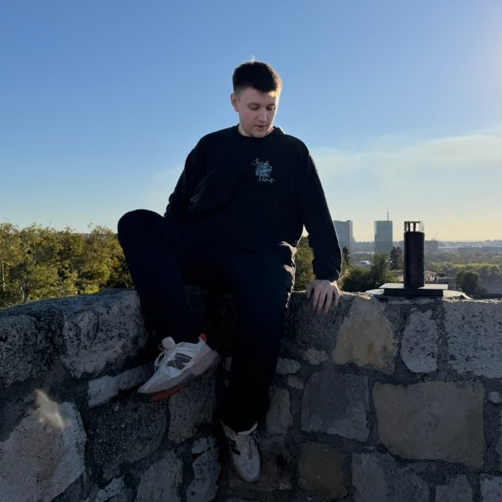

# Как добавить свою фотографию

## Шаг 1: Подготовьте фотографию

1. Выберите фотографию с соотношением сторон **4:5** (вертикальный прямоугольник)
2. Рекомендуемый размер: **560×700 пикселей**
3. Формат: JPG, PNG или WebP
4. Оптимизируйте размер файла (желательно до 200-300 KB)

## Шаг 2: Добавьте файл в проект

Поместите вашу фотографию в папку:
```
portfolio/assets/img/
```

Например:
```
portfolio/assets/img/photo.jpg
```

## Шаг 3: Обновите HTML

Откройте файл `index.html` и найдите строку:

```html

```

Замените на:

```html

```

## Шаг 4: Проверьте результат

Откройте `index.html` в браузере и проверьте, что фотография отображается корректно.

---

## Дополнительно: Оптимизация фотографии

Если файл слишком большой, используйте онлайн-сервисы для сжатия:
- [TinyPNG](https://tinypng.com/) — для PNG/JPG
- [Squoosh](https://squoosh.app/) — для всех форматов
- [CompressJPEG](https://compressjpeg.com/) — для JPG

Цель: файл размером **до 300 KB** для быстрой загрузки.